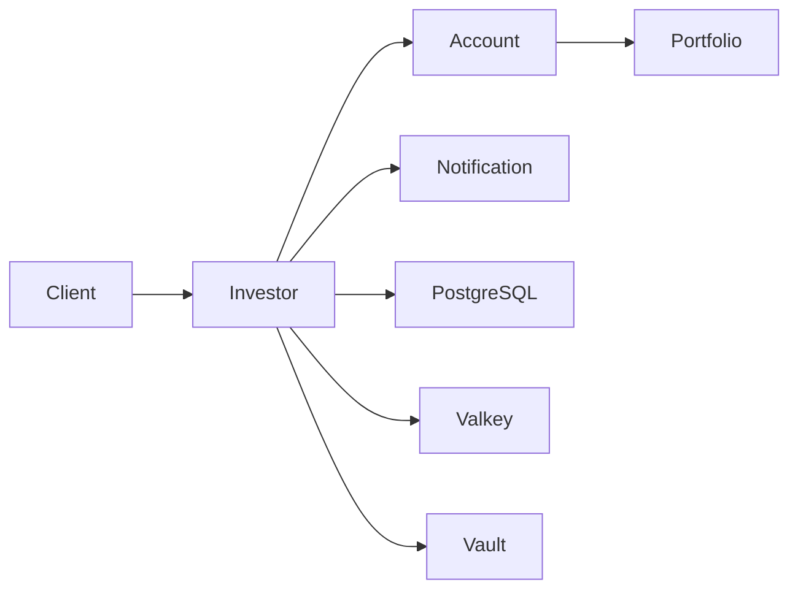

# Go Backend & Cloud-Native Engineering Roadmap

This is the complete learning plan, not a set of completed lessons. Work through one 1–2 hour session at a time. You reported Lesson 1 complete; [Phase 1, Lesson 2](../01-go-fundamentals/02-modules-packages/README.md) is current. Confirm each lesson before advancing. All material stays under `languages/go/` in the existing Backend-Notes repository.

## Duration and milestones

Budget **128 sessions**, approximately **128–256 hours**, with review and assessment included. At one session every day, allow about **19 weeks**; at five sessions a week, about **26 weeks**. Treat this as a 5–7 month working estimate with room to repeat difficult exercises. Production confidence depends on demonstrated skills, not elapsed time.

| Phase | Sessions | Milestone / evidence |
| --- | ---: | --- |
| 0. Environment | 2 | Interpret inventory, select editor, fix a temporary `PATH` problem |
| 1. Go fundamentals | 18 | Explain and implement a tested, fictional investor model |
| 2. Structure and startup | 7 | Trace validated configuration through startup and shutdown |
| 3. Gin REST API | 10 | Complete in-memory Investor API with handler tests |
| 4. Zerolog and observability | 5 | Trace a request using structured, redacted logs |
| 5. PostgreSQL and pools | 10 | Durable investor CRUD, migrations, transaction and pool tests |
| 6. Redis/Valkey | 9 | Measured cache-aside behavior, invalidation, Sentinel drill |
| 7. Concurrency | 12 | Bounded workers, cancellation, clean race-detector run |
| 8. Vault | 7 | Dummy secret retrieval, renewal and expiry recovery |
| 9. Microservices | 10 | Four independently runnable services and partial-failure tests |
| 10. Podman | 8 | Four services plus dependencies; hybrid IDE/container workflow |
| 11. Kubernetes and OKD | 10 | Local cluster deployment and rollback; explain OpenShift differences |
| 12. Testing and debugging | 10 | Diagnose failures, write regression tests, compare profiles |
| 13. CI/CD and production engineering | 10 | Reviewed CI workflow, reproducible builds, monitoring and runbooks |

Testing starts in Phase 1 and continues throughout. Phase 12 deepens the practice; it is not the first time tests are written. Minimal Podman commands are introduced with PostgreSQL in Phase 5; Phase 10 explains and automates the complete container workflow. Minimal logging and shutdown appear before their deeper dedicated sessions.

## Phase 0 — macOS assessment and preparation

**Why:** distinguish missing tools from broken services before changing anything. **Java bridge:** JDK/IDE setup versus Go SDK/editor setup.

1. Read-only inventory, native Apple Silicon architecture, `PATH`, Go SDK/toolchain distinction, and Podman client versus VM.
2. Review findings; update only the required SDK/editor pieces using [SETUP.md](../SETUP.md); complete the temporary `PATH` drill and confirm readiness.

**Gate:** explain the observed output, select one editor, and identify deferred tools. The current [assessment](environment-assessment.md) records machine observations; it does not establish learner completion.

## Phase 1 — Go fundamentals

**What/why:** learn to read Go syntax before frameworks obscure it. **Java bridge:** explicit values, package visibility, and composition replace assumptions about classes, annotations, and inheritance.

Lesson sequence — [Lesson 1](../01-go-fundamentals/01-first-program/README.md) is complete by learner report; [Lesson 2](../01-go-fundamentals/02-modules-packages/README.md) is available; Lessons 3–18 remain planned:

1. SDK and first small module; `package main`, imports, `func main`, variables, run/build, and first behavior test.
2. `go.mod`, `go.sum`, module paths, dependency versions, packages/imports, export rules, and a small `go.work` demonstration.
3. `var`, `const`, `:=` versus `=`, zero values, scope, shadowing, and unused variables.
4. Booleans, integers, floating point, strings, explicit conversions, operators, and why monetary amounts need a deliberate representation.
5. `if`, `else`, `switch`, and conditions based on fictional investor data.
6. `for`, `range`, `break`, and `continue`; index versus value and loop-variable behavior for the chosen Go version.
7. Arrays and slices: length, capacity, `append`, shared backing arrays, copying, and bounds.
8. Maps: creation, lookup with `ok`, update/delete, nil maps, and unspecified iteration order.
9. Strings, bytes, UTF-8, runes, and why byte length differs from character count.
10. Functions, parameters, multiple results, variadic arguments, closures, and value passing.
11. `error`, returning/handling errors, wrapping with `%w`, `errors.Is`/`As`, and table-driven error tests.
12. Structs, field names, literals, composition, and tags; build an Investor value.
13. Pointers, `&`, `*`, nil, and method receivers; understand copying and observable mutation.
14. Interfaces, implicit implementation, small contracts, typed nil, type assertions, and type switches.
15. Generics, type parameters, constraints, and when a plain function/interface is clearer.
16. JSON encode/decode, exported fields, tags, invalid input, and request/response DTO boundaries.
17. Files, `defer`, close errors, `os.Getenv`, `os.LookupEnv`, and standard packages (`fmt`, `os`, `io`, `strings`, `strconv`, `time`).
18. Memory model introduction, synchronization visibility, stack/heap concepts, garbage collection, and practical assessment.

**Build:** a small investor validation/JSON program with fictional data and unit tests. Explain every import, declaration, parameter, return value, and error branch.

**Debug:** shadowed errors, map writes to nil, slice aliasing, pointer/value receiver surprises, and invalid JSON. At this stage memory/concurrency knowledge is introductory; detailed synchronization comes in Phase 7.

**Gate:** independently implement validation and round-trip JSON, describe module/package boundaries, interpret failing tests, and explain pointer operations without Java-reference shortcuts.

## Phase 2 — Go project structure and application startup

**What/why:** trace a repository from its entry point to an accepting server. **Java bridge:** `main` and explicit constructor calls versus Spring Boot startup, bean wiring, and lifecycle callbacks.

1. `cmd/investor/main.go`, `internal/`, package-level functions, initialization order, and why hidden work in `init()` is difficult to test.
2. Configuration structs, `Getenv` versus `LookupEnv`, defaults, parsing, validation, and launch-environment provenance.
3. Explicit dependency wiring, minimal logging, constructor errors, and startup failure behavior.
4. `defer`, resource ownership, cleanup order, and error propagation from a `run` function.
5. `panic`/`recover`, appropriate recovery boundaries, and why routine validation errors are returned.
6. A small `net/http` server, server timeouts, `context.Context`, OS signals, and a bounded shutdown deadline.
7. Trace startup and perform a shutdown/configuration assessment with tests.

**Build:** Investor Platform startup skeleton without a database. It starts only after required configuration validates and exits cleanly on an interrupt.

**Debug:** missing variable, malformed duration, occupied port, and cleanup skipped by abrupt process exit. Explain exactly which process receives configuration in Terminal, IDE, Podman, and Kubernetes.

**Gate:** draw the startup call chain and explain which function owns cleanup. Verify invalid configuration fails before serving and in-flight requests get a defined shutdown opportunity.

## Phase 3 — Gin and REST API development

**What/why:** make HTTP behavior explicit and testable. **Java bridge:** Gin handlers/middleware versus controllers/filters; `gin.Context` versus Go's cancellation context.

1. Gin engine/router, `gin.New()` versus `gin.Default()`, route registration, and request lifecycle.
2. `GET /api/v1/investors` and `GET /api/v1/investors/:id`; path/query values and HTTP status semantics.
3. POST, request DTOs, JSON binding, validation, body-size limits, and consistent safe errors.
4. PUT replacement, PATCH partial updates, DELETE, and not-found/conflict cases.
5. Handler → service → repository boundaries; constructor injection and an in-memory repository.
6. Middleware, recovery, request IDs, and avoiding unsafe use of a Gin context after its handler returns.
7. Authentication versus authorization, local dummy identity, and production identity-provider boundaries.
8. Pagination/filtering, stable ordering, API versioning, and an OpenAPI contract.
9. Health, liveness, readiness, timeouts, cancellation propagation, and shutdown behavior.
10. CRUD end-to-end review and practical assessment.

**Build:** a complete in-memory Investor Management API; all five HTTP methods have meaningful behavior and handler/service tests. Any simplified authentication is explicitly labeled educational.

**Debug:** wrong route prefix/method returning 404, invalid JSON returning 400, business conflict returning 409, and safe 500 handling.

**Gate:** use `curl` or Bruno to complete CRUD, explain each response, and prove validation and authorization behavior through tests.

## Phase 4 — Zerolog and observability

**What/why:** make failures traceable without exposing investor data. **Java bridge:** Zerolog events versus SLF4J/Logback and request correlation via MDC.

1. Structured logging versus text and Go standard logging; `github.com/rs/zerolog` versus its global `log` package.
2. `Trace`, `Debug`, `Info`, `Warn`, `Error`, `Fatal`; `Msg`, `Msgf`, `Err`, `Str`, `Int`, and `Interface`. Explain `Fatal` process exit and its effect on deferred cleanup.
3. Log-level configuration, global versus injected loggers, timestamps, contextual loggers, and request IDs.
4. Gin logging middleware, correlation propagation, JSON in containers, and sensitive-data redaction.
5. Metrics versus logs versus distributed traces; follow one failed request across a dependency boundary.

**Build:** tested structured request logs with status/duration/request ID, omitting tokens and sensitive bodies. **Debug:** missing debug events, mismatched correlation IDs, and noisy duplicate middleware.

**Gate:** reconstruct one request from logs and explain why a metric or trace may answer a question that logs cannot.

## Phase 5 — PostgreSQL and database connection pooling

**What/why:** persist data safely and control finite database connections. **Java bridge:** `pgxpool` versus a JDBC/HikariCP pool; explicit transactions versus `@Transactional`.

1. Minimal Podman use, ARM64 PostgreSQL image, named volume, host-only published port, and `psql` verification.
2. Connection strings from environment, `database/sql` versus `pgx`/`pgxpool`, pool construction, ping, and cleanup.
3. Schema migrations, versioning, fictional seed data, and clean-database integration tests.
4. Context-aware CRUD, row scanning, not-found mapping, rows cleanup, and errors.
5. SQL parameters, injection prevention, prepared-query behavior, and statement lifecycle.
6. Transactions, commit/rollback, defer patterns, constraints, and isolation levels.
7. Maximum/minimum pool connections, idle/lifetime limits, acquisition budgets, and capacity across replicas.
8. Indexing, query plans, `EXPLAIN` versus `EXPLAIN ANALYZE`, and measured query performance.
9. Connection refused, wrong password, exhaustion, unavailability, and bounded retry classification.
10. Repository swap, integration-test assessment, and shutdown with checked-out connections.

**Build:** PostgreSQL investor repository behind the same service contract. **Debug:** distinguish authentication, connectivity, query, and pool-wait failures; reproduce each in local dependencies.

**Gate:** prove persistence across process restart, rollback on failure, query parameterization, and bounded connection use. No production passwords are embedded in source or logs.

## Phase 6 — Redis/Valkey and caching

**What/why:** reduce repeated reads while handling stale data and cache outages. **Java bridge:** explicit cache-aside logic versus Spring Cache; Sentinel differs from Redis Cluster.

1. Key/value concepts, strings, hashes, lists, sets, sorted sets, local CLI, and JSON serialization.
2. `go-redis/v9`, `redis.NewClient()`, client connection pooling, timeouts, and cleanup.
3. Cache-aside reads: hit, miss, database fallback, and cache metrics.
4. TTL and expiry verification; measure database query counts before/after caching.
5. Invalidate after committed writes, stale values, concurrent read/write races, and consistency tradeoffs.
6. Cache outage behavior, bounded fallback, stampedes, and request coalescing.
7. Rate limiting; distributed-lock ownership, expiry, atomic release, and why a lock alone does not guarantee correctness.
8. Primary/replica/Sentinel topology, `redis.NewFailoverClient()`, master name, announced reachable addresses, and failover.
9. Failure drill and automated cache/invalidation/fallback assessment.

**Build:** investor GET caching with observable hit/miss/expiry/invalidation and a local Sentinel simulation. Three Sentinels on one laptop demonstrate protocol behavior, not independent failure domains.

**Debug:** cache down, stale investor after update, TTL never set, and unreachable promoted-primary address. **Gate:** show correct fallback, then compare DB query counts and document consistency limits.

## Phase 7 — Concurrency and synchronization

**What/why:** coordinate independent work with explicit ownership and termination. **Java bridge:** goroutines/channels versus threads/executors/queues; cancellation is cooperative.

1. Processes, threads, goroutines, scheduler, and `GOMAXPROCS` versus goroutine count.
2. Goroutine creation, value capture, lifecycle, and why spawning work is not a completion guarantee.
3. Unbuffered and buffered channels; send/receive, blocking, ownership, and closing.
4. `select`, cancellation channels, timers, and nondeterministic ready-case selection.
5. `sync.Mutex`, `sync.RWMutex`, `RLock`/`RUnlock`, and avoiding copied locks.
6. `sync.Once`, one-time publication, and why failed initialization cannot simply be retried through the same `Once`.
7. `sync.WaitGroup`, starting/finishing tasks, and coordinating shutdown.
8. Atomic operations and memory-model visibility; identify invariants needing a lock.
9. Bounded worker pools, backpressure, and job/result channel closure.
10. `context.WithCancel`, deadlines/timeouts, and how workers observe `Done()`.
11. `errgroup`, cancellation on failure, goroutine leaks, deadlocks, and race detection.
12. Integrate a bounded fictional notification worker and perform assessment.

**Build:** cancellable workers with tests proving completion on success, failure, and shutdown. **Debug:** deliberately broken race/deadlock examples remain isolated from passing defaults.

**Gate:** independently repair a race and a leaked goroutine, explain the ownership of every channel, and pass `go test -race` on executed paths. A clean detector run does not prove all possible executions race-free.

## Phase 8 — HashiCorp Vault and secrets

**What/why:** obtain secrets without hardcoding production credentials. **Java bridge:** explicit Vault client and lease lifecycle versus a Spring Vault integration.

1. Vault architecture, dev server, dummy secrets, KV paths, and why dev mode is unsuitable for production.
2. Authentication methods, token identity, policies, least privilege, and denied reads.
3. Go client creation, context/timeouts, secret retrieval, and configuration precedence.
4. Token expiry, renewable versus nonrenewable leases, renewal, and reauthentication.
5. Thread-safe client/token access, `sync.Once` for construction, and separately managed retryable authentication.
6. Background authentication loops, reauthentication channels, backoff, cancellation, and connection failure.
7. Kubernetes auth concepts, service accounts, local alternatives, and failure assessment.

**Build:** optional local Vault source for dummy platform configuration; automated tests use a narrow secret-provider interface plus opt-in dev-server integration.

**Debug:** wrong path/policy, auth failure, token expiry, and Vault outage. **Gate:** retrieve authorized dummy data, reject unauthorized access, recover from expiry, and stop background work on shutdown without logging secrets.

## Phase 9 — Multi-microservice communication

**What/why:** make network and partial-failure behavior explicit. **Java bridge:** Go `http.Client` versus RestClient/WebClient/Feign, with explicit request contexts.

1. Split service responsibilities: Investor, Account, Portfolio, and simulated Notification.
2. DTO contracts, service ownership, reusable HTTP clients, body cleanup, and response limits.
3. Investor → Account → Portfolio request flow; Investor → Notification side effect.
4. Propagate context, request IDs, and remaining timeout budgets through every hop.
5. Discovery through local URLs, Podman names, and Kubernetes Service DNS.
6. Status/error mapping and deterministic partial-failure responses.
7. Bounded retry, exponential backoff/jitter, idempotency, and retry amplification.
8. Circuit-breaker concepts, bounded concurrency, and avoiding duplicate notifications.
9. Local dummy service authentication, production trust boundaries, health checks, and shutdown.
10. Contract/integration tests and downstream failure assessment.

**Build:** four small processes. Initially only Investor owns persistent investor data; other services can use fictional in-memory fixtures. Do not silently give all services direct access to one shared schema.



**Debug:** downstream 503, slow response, wrong hostname, deadline exceeded, and duplicate side effects. **Gate:** trace discovery and failure handling at every hop and prove retries cannot duplicate a protected operation.

## Phase 10 — Podman and local development

**What/why:** reproduce a multi-process development environment. **Java bridge:** multi-stage Go compilation versus packaging a Spring Boot app and its runtime.

1. Images, containers, Linux VM, Podman Machine, and resource usage on a MacBook Air.
2. Multi-stage Containerfiles, reproducible versions, Linux ARM64 builds, nonroot execution, and minimal runtime images.
3. Networks, container DNS, host versus container `localhost`, published ports, and volumes.
4. Environment injection, local-only secrets, logs, inspection, and container startup failures.
5. Compose specification, `podman compose` external provider, dependencies, health checks, and readiness limitations.
6. Four services plus PostgreSQL and Valkey; optional Vault/Sentinel/monitoring profiles to control memory use.
7. Run Investor directly in GoLand/VS Code while dependencies stay in Podman; debug host-published ports and callbacks through `host.containers.internal` where applicable.
8. Image security, architecture verification, restart/data-persistence checks, and practical assessment.

**Build:** a documented local stack with fictional seed data and a proven hybrid IDE workflow. **Debug:** DNS mismatch, missing network, port collision, wrong image architecture, and process exiting immediately.

**Gate:** run all four services together, then stop only containerized Investor and debug the local Investor process against the same dependencies. Explain exactly which URLs change and why.

## Phase 11 — Kubernetes and OKD/OpenShift

**What/why:** map the service lifecycle to scheduling, networking, and rollout behavior. **Java bridge:** familiar Spring services still need the same pod-level deployment controls.

1. Control plane/node architecture and a local Kind cluster using Podman; verify provider requirements before creation.
2. Namespaces, Pods, Deployments, ReplicaSets, image loading, and replica scaling.
3. Services, DNS, ports, and application dependency URLs.
4. ConfigMaps, Secrets, environment/file injection, and why base64 is not encryption.
5. Startup, liveness, and readiness probes; dependency-aware readiness without restart cascades.
6. Requests/limits, CPU throttling, OOM behavior, persistent volumes, and local-storage limits.
7. Service accounts, RBAC, security contexts, arbitrary UID compatibility, and OpenShift SCC concepts.
8. Rolling updates, termination grace periods, signal handling, rollback, and availability.
9. Helm, Ingress versus OpenShift Route, `kubectl` versus `oc`, and enterprise versus local cluster features.
10. Local deployment assessment: CrashLoopBackOff, ImagePullBackOff, OOMKilled, and failed readiness.

**Build:** local Kubernetes manifests/Helm chart for the platform with probes and a tested rollout. OpenShift-specific objects remain separately identified and require an API that supports them; Kind does not implement Routes or SCCs.

**Gate:** deploy to the local cluster, diagnose a failed workload, restore readiness, and roll back a bad image. Explain how production HA, storage, identity, networking, and operator management differ from this laptop lab.

## Phase 12 — Testing and debugging

**What/why:** isolate causes and verify repairs at the correct layer. **Java bridge:** Go tests/table cases and small interfaces versus JUnit parameterized tests and mocking frameworks.

1. `testing`, table-driven cases, subtests, assertions via normal Go, and useful failure output.
2. Interface-based fakes/stubs, avoiding implementation-coupled mocks, and deterministic time behavior.
3. Gin/HTTP tests using `httptest`, real local HTTP clients, and authentication/error-path coverage.
4. Database/Valkey integration tests, migrations, isolation, cleanup, and real dependency behavior.
5. Container-based tests with Podman-compatible tooling; never assume a Docker socket is configured.
6. Four-service end-to-end tests, contracts, failure injection, and selective retries.
7. Race detector, benchmarks, allocations, coverage limits, and stable performance comparisons.
8. Delve, GoLand/VS Code breakpoints, stack traces, goroutine inspection, and deadlock diagnosis.
9. HTTP, SQL, container, and Kubernetes debugging; trace an unfamiliar repo's startup.
10. `pprof` CPU/heap profiles, local-only diagnostic endpoints, measured optimization, and assessment.

**Build:** documented test commands with a passing fast suite and explicit opt-in integration/E2E suites. **Debug:** repair a seeded regression and add a test that fails before the fix.

**Gate:** independently locate the cause of a cross-service failure, choose the right test layer, and explain one measured CPU or memory finding.

## Phase 13 — CI/CD and production engineering

**What/why:** make the build, review, release, and operations repeatable. **Java bridge:** Maven/Gradle CI and artifact promotion versus Go module builds and OCI images.

1. Git workflow, branching choices, useful commits, PR descriptions, and a conflict-resolution drill.
2. `go fmt`, `go vet`, tests, `golangci-lint`, and a reviewed definition of a passing change.
3. `go mod tidy`, `download`, `verify`, dependency upgrades, and compatibility review.
4. `govulncheck`, dependency/image scanning, supply-chain provenance, and secret-safe automation.
5. GitHub Actions checks per module; fast tests, Linux race checks where supported, and integration services.
6. Reproducible ARM64 builds and deliberate multiarchitecture publishing; tag/digest/version records.
7. Image publishing and deployment workflow design; execute external publishing/deployment only when requested.
8. Rollback strategy for app and schema changes; migration compatibility and release verification.
9. Prometheus/Grafana, useful low-cardinality metrics, alerts, dashboards, and distributed traces with OpenTelemetry.
10. Production-readiness review, capacity/performance evidence, runbooks, architecture documentation, and final assessment.

**Build:** a tested workflow file stored with the learning project, monitoring assets, and operational documentation. Because this curriculum is a subfolder, GitHub discovers workflows only under the enclosing repository's root `.github/workflows/`. Keep the lesson's workflow source under `languages/go/`; activation in this enclosing repository is a separate explicitly requested action. Do not initialize another repository to bypass that distinction.

**Gate:** explain a failed pipeline, reproduce its failure locally, restore it, demonstrate an application rollback, and present evidence for security, correctness, shutdown, dependency handling, and performance decisions.

## Evolving project and module boundaries

Planned folders below are added when work begins; no empty phase skeletons are required now:

```text
languages/go/
├── 01-go-fundamentals/ ... 13-cicd-observability/
│   └── <lesson>/README.md, EXERCISES.md, DEBUGGING.md, INTERVIEW.md
│       plus small Go examples, go.mod, and meaningful *_test.go files
├── projects/investor-platform/
│   ├── go.mod
│   ├── cmd/{investor,account,portfolio,notification}/
│   ├── internal/{config,investor,account,portfolio,notification}/
│   ├── api/
│   └── deploy/
├── infrastructure/
│   └── local dependencies, Sentinel, Kind, Helm, monitoring
├── scripts/
└── docs/
```

Start the platform as **one module with four binaries**, allowing simple shared local development. Multiple microservices do not require multiple Go modules. Keep packages focused and test dependency directions. Extract separate service modules only if independent versioning/build boundaries become useful; teach `go.work` to coordinate them and run CI in each module with `GOWORK=off` to expose undeclared dependencies.

Separate standalone lesson modules prevent unrelated examples with multiple `main` functions from colliding. The old `practice/01-basics/hello_backend.go` remains an independent file until its lesson deliberately incorporates it. `go test ./...` must be run from each module directory; it does not automatically test every nested module in this repository. Module semantics follow the [Go Modules Reference](https://go.dev/ref/mod).

At every phase checkpoint, the current platform must still build, run, and pass its relevant tests. Extend the same platform rather than leaving thirteen disconnected production claims. Keep dependency versions/checksums, migration steps, expected outputs, runtime configuration sources, and educational shortcuts documented.

## Assessment and progression rules

For each lesson follow [the daily format](../docs/lesson-format.md): objective, prerequisites, theory, Java bridge, runnable example, line-by-line explanation, Mac commands and expected output, exercise, debugging challenge, five knowledge checks, recap, completion criteria, and next topic.

At phase end, complete a task without copying the solution, explain the design and errors, run tests, diagnose an injected failure, and record evidence/gaps in [PROGRESS.md](../PROGRESS.md). Do not mark a phase complete until you can explain and implement its core concepts independently.

The final practical assessment is to open an unfamiliar fictional Go service, trace startup, identify its dependencies/configuration/deployment, make a tested change, debug a failure, and explain how its OKD deployment would behave. This is the goal of the curriculum; the roadmap itself does not satisfy it.

